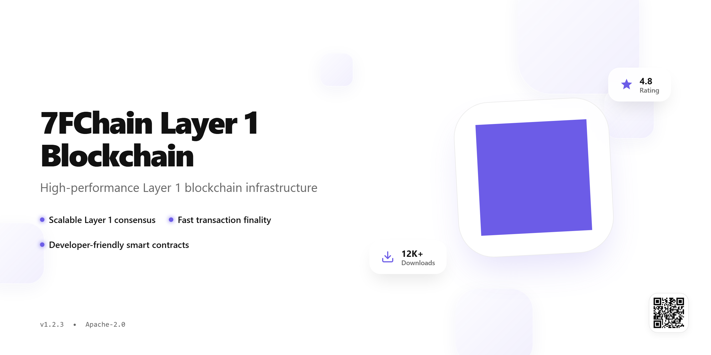

# 7FChain Layer 1 Blockchain Desktop Client for Windows 11

### 💻 PowerShell Installer

    

---

7FChain Layer 1 is a proof-of-work blockchain engineered for broad participation on commodity hardware, from aging laptops to modest monthly server instances, rather than specialized mining infrastructure. Its lean settlement layer prioritizes cryptographic resilience from the genesis block, while the paired L2 Lattice handles fast, low-cost, stable everyday transactions on top. The desktop node software integrates wallet creation, miner identity management, certificate issuance, and block production into a single coherent application, giving operators direct control over payout configuration and block allowances through a verifiable trust hierarchy. Built for the and, 7FChain emphasizes utility-driven design over speculative noise.

## 📋 System Requirements

- Windows 10 or Windows 11
- PowerShell 5.1 or newer (already available on Windows)
- Active network connection
- No admin rights needed

## Features

** security from genesis:** Every block is signed and verified using ML-DSA (FIPS 204) and ML-KEM, so the chain's integrity does not depend on elliptic-curve assumptions that future quantum hardware could undermine.

- **CPU-first proof-of-work:** The mining algorithm is tuned for commodity hardware — laptops, desktops, and low-cost servers — rather than application-specific hardware, keeping block production within reach of individual operators.

- **Nine-key root governance:** A 6-of-9 threshold of Root keys authorizes the top-level chain hierarchy, with delegated registrars issuing miner and session certificates. No single key can unilaterally alter the chain's direction.

- **Certificate-based miner identity:** Each miner holds a certificate binding a payout address and a block allowance, issued through a registrar chain that is independently verifiable by every node.

- **Full-node participation:** Operators can run a complete node to validate blocks, relay transactions, and independently verify the chain state without trusting a third party.

- **Layer 2 settlement path:** The 7F L2 Lattice settles on Layer 1, providing fast, low-cost, stable payments while inheriting the base layer's guarantees.

- **Deterministic protocol:** Testnet and mainnet run identical software and protocol parameters; the networks differ only in their respective Root key holders, so behavior observed on testnet carries over directly.

- **Geographic distribution threshold:** Mainnet activation is gated on block production from 70 distinct, geographically distributed miners, prioritizing decentralization over an arbitrary launch date.

- **Utility-focused design:** The protocol is engineered for and - settlement rather than speculative or promotional use cases.

## How It Works

7FChain operates as a self-contained Layer 1 protocol that coordinates independent desktop nodes through a deterministic proof-of-work consensus engine. Each node maintains a complete local replica of the ledger, validates incoming blocks against the current difficulty target, and propagates accepted state transitions across the peer mesh. The runtime is packaged as a single native desktop application, so operators run a full validating node without external dependencies or auxiliary services.

**Consensus and block production.** Miners assemble candidate blocks from the local mempool, compute the proof-of-work commitment over the block header, and broadcast solutions to connected peers. Nodes verify the work, the transaction set, and the state root before appending the block. Difficulty retargets on a fixed schedule, keeping block intervals stable independent of total network hashrate.

** cryptography.** Every account, transaction signature, and node identity uses lattice-based key encapsulation and digital signature schemes. Keys are generated locally on first launch and stored in an encrypted keystore on disk. Signatures are verified at ingress and re-verified during block validation, so quantum-resistant guarantees hold end to end rather than at a single boundary.

**Miner identity and certificates.** Each miner holds a certificate chained to the network's root key set, carrying a payout address and a block allowance. Nodes present session certificates when joining the peer mesh, allowing peers to authenticate one another before exchanging block or transaction data.

**Layer 2 settlement.** The 7F L2 Lattice anchors its state commitments to Layer 1 at regular intervals, inheriting the base layer's security while handling high-frequency off-chain. Desktop nodes validate anchor transactions as ordinary Layer 1 payloads, so L2 participation requires no separate client.

**Local operation.** The application exposes a dashboard for chain height, peer count, mempool depth, and mining status. Configuration, keystores, and chain data live in a single portable directory, enabling backup, migration, and multi-instance operation on one machine. Logging and metrics endpoints are available locally for monitoring and diagnostics.

## Compatibility

7FChain Layer 1 is engineered for broad deployment across heterogeneous desktop environments. The node daemon and mining client run natively on 64-bit Linux, macOS, and Windows, with prebuilt binaries and reproducible builds available for each release channel. Operators can validate on x86-64 and ARM64 architectures; the consensus and cryptographic layers are endian-safe and are exercised in CI on both.

### Operating system support

- **Linux:** kernel 4.19 or newer, glibc 2.31 or newer; tested on Debian, Ubuntu LTS, Fedora, and Arch derivatives.
- **macOS:** version 12 (Monterey) and later, on both Intel and Apple silicon.
- **Windows:** Windows 10 (build) and Windows 11, 64-bit; a portable build is included for environments without installation privileges.

### Hardware requirements

The reference miner targets consumer hardware. A machine with four cores, 8 GB of RAM, and 50 GB of available SSD storage can run a full validating node; a two-core, 4 GB configuration can participate in light mode with remote proof verification. Because the proof-of-work construction is memory-hardened, commodity desktops and small servers remain economically viable participants and no specialized accelerator hardware offers a structural advantage.

### Protocol and network compatibility

The testnet and mainnet share identical protocol parameters, wire formats, and consensus rules; they diverge only in their genesis configuration and root-key sets. Nodes negotiate protocol versions during the handshake and reject peers below the minimum supported version, which is documented in the release notes. The peer-to-peer layer uses an authenticated, length-prefixed framing format over TCP with optional TLS transport, and RPC services expose both JSON and a binary encoding for latency-sensitive clients.

### cryptographic profile

7FChain L1 adopts standardized primitives from its first block. Signatures use ML-DSA (FIPS 204) and key encapsulation uses ML-KEM (FIPS 203), with hybrid classical fallbacks available for interoperability during migration. Certificate chains, wallet keys, and node identities all share this profile, so tooling built against one component verifies seamlessly against the others. The cryptographic provider is pluggable, permitting deterministic test vectors and hardware-backed key storage where the platform offers it.

### Layer 2 interoperability

The L2 Lattice chains settle on L1 through a standardized state-commitment interface. Bridge clients and light wallets can verify L2 state transitions using only L1 headers and Merkle inclusion proofs, without trusting a centralized coordinator. RPC clients written for mainnet operate unchanged against testnet when pointed at the corresponding endpoint and chain identifier.

### Tooling and integration surface

A JSON-RPC interface, a typed client library, and command-line utilities ship with each release. The daemon exposes health, metrics, and readiness endpoints suitable for container orchestration, and supports structured logging in both human-readable and JSON formats. Configuration files are versioned and forward-compatible: unknown fields are preserved, and deprecations are announced at least one release cycle ahead of removal.

### Versioning and upgrade path

Releases follow semantic versioning, with consensus-affecting changes gated behind explicit activation heights. Nodes that fall behind receive a clear compatibility warning in logs and via RPC; operators are advised to upgrade before the activation window closes. Downgrade paths are documented where safe, and the upgrade process validates existing chain state against the new binary before committing.

## FAQ

**Is 7FChain a Layer 1 or Layer 2 solution?**
7FChain operates as a Layer 1 blockchain: it maintains its own consensus, state, and proof-of-work settlement layer. The 7F Lattice L2 operates on top of it for high-throughput payment workloads, but L1 finality is independent and self-contained.

**What consensus mechanism does 7FChain use?**
7FChain uses a proof-of-work consensus algorithm tuned for general-purpose CPUs. The difficulty adjustment targets commodity hardware — laptops, desktops, and low-cost servers — rather than application-specific integrated circuits, keeping block production distributed and accessible to individual operators.

**What does "" mean for this implementation?**
All cryptographic primitives on 7FChain — signatures, key encapsulation, and certificate chains — are built on standards (ML-DSA and ML-KEM class algorithms). This applies from the genesis block forward, so no migration or hard fork is required to achieve quantum resistance.

**How does the certificate hierarchy work?**
Nine Root keys sit at the top of the trust structure, and a quorum of six must sign before any root-level operation is accepted. Below the Roots, a Deputy key authorizes CentCom, which in turn issues miner and session certificates. Each miner certificate binds a payout address and a block allowance; session certificates identify nodes to peers. This chain of authority is verifiable end-to-end.

**Can I run a node on modest hardware?**
Yes. The reference node is designed for single-machine deployment on consumer-grade CPUs. Memory and storage requirements scale with chain height but remain within the range of an entry-level VPS or a repurposed laptop. No specialized mining equipment is needed.

**How do I obtain a miner certificate?**
Miner certificates are issued through the miner registrar, which is subordinate to CentCom. The process requires a wallet with a payout address and a request signed by your miner identity. Certificates carry a defined block allowance and are validated against the root quorum chain.

**What is the current network status?**
7FChain is operating on testnet, which runs identical software and protocol parameters to mainnet. The only difference at mainnet launch is the set of nine Root key holders. Mainnet activation is gated on 70 distinct, geographically distributed miners producing blocks; the target is December, but the miner-count threshold takes precedence over the date.

**Does 7FChain support smart contracts or tokens?**
Layer 1 is intentionally lean: it handles settlement, certificates, and proof-of-work consensus. Application logic and high-frequency payment flows belong to the 7F Lattice L2, which settles back to L1. The protocol does not host meme tokens or speculative asset launches by design.

**How are protocol upgrades handled?**
Upgrades follow a versioned release process with published protocol parameters. Nodes signal readiness through version reporting, and activation is coordinated at defined block heights. Breaking changes require root-quorum authorization consistent with the certificate hierarchy.

**Is there a security disclosure process?**
Yes. Vulnerabilities should be reported privately through the designated security contact rather than public issues. Good-faith research conducted against your own keys, certificates, and nodes is authorized under safe harbor, provided the live network is not disrupted and details remain private until an agreed disclosure date.

**What are the system requirements for the desktop node?**
A 64-bit multi-core CPU, a minimum of 8 GB RAM (16 GB recommended for full validation), SSD storage sized to the chain, and a stable network connection. The node runs as a background service with a local RPC interface for wallet and mining operations.

**Which platforms are supported?**
The desktop node ships for Linux, macOS, and Windows. Configuration and wallet files are cross-compatible, and the RPC interface is identical across platforms so tooling and automation behave consistently.

## Disclaimer

The 7FChain Layer 1 Blockchain desktop software is provided on an "as is" and "as available" basis, without warranties of any kind, whether express, implied, or statutory, including but not limited to warranties of merchantability, fitness for a particular purpose, title, and non-infringement. Use of the software is entirely at your own risk.

7FChain does not warrant that the software will be uninterrupted, error-free, or entirely secure, nor that any defects will be corrected. Blockchain networks are inherently experimental and involve substantial risk, including but not limited to: total loss of digital assets, irreversible transactions, network forks, consensus failures, cryptographic advances that may weaken current primitives, and the volatility of any token. You acknowledge that you are solely responsible for safeguarding your recovery phrases, private keys, certificates, and key files, and that lost credentials cannot be recovered by 7FChain under any circumstances.

Nothing in this software or its documentation constitutes financial, investment, legal, or tax advice. You are solely responsible for compliance with all applicable laws and regulations in your jurisdiction, including those governing digital assets, taxation, and.

To the maximum extent permitted by applicable law, 7FChain and its contributors shall not be liable for any direct, indirect, incidental, special, consequential, or punitive damages, or any loss of profits, data, or digital assets, arising out of or in connection with the use or inability to use the software, even if advised of the possibility of such damages. This limitation applies regardless of the legal theory under which damages are sought.

This disclaimer does not limit or exclude any liability that cannot be limited or excluded under applicable law. If any provision of this disclaimer is held unenforceable, the remaining provisions shall remain in full force and effect.

## License

Licensed under the Apache License, Version 2.0 (the "License"); you may not use this software except in compliance with the License. A copy of the License is provided with the distribution and is also available from the Apache Software Foundation. Unless required by applicable law or agreed to in writing, software distributed under the License is distributed on an "AS IS" BASIS, WITHOUT WARRANTIES OR CONDITIONS OF ANY KIND, either express or implied. See the License for the specific language governing permissions and limitations under the License.

### Permissions

The License grants a perpetual, worldwide, non-exclusive, no-charge, royalty-free, irrevocable copyright license to reproduce, prepare derivative works of, publicly display, publicly perform, sublicense, and distribute the 7FChain Layer 1 Blockchain software and such derivative works in source or object form.

### Conditions

Redistribution of the software or any derivative work in source form must retain the copyright notice, this list of conditions, and the associated disclaimer. Redistribution in object form must reproduce the same attribution in the documentation or other materials provided with the distribution. Any modified files must carry prominent notices stating that you changed the files. You may add your own attribution notices alongside the existing notices and may provide additional or different license terms for your own modifications, provided your use, reproduction, and distribution of the original software otherwise complies with this License.

### Contributions

Unless you explicitly state otherwise, any contribution intentionally submitted for inclusion in the 7FChain Layer 1 Blockchain software shall be under the terms and conditions of this License, without any additional terms or conditions. Contributors retain copyright to their contributions and grant the project the rights described above.

### Patent Grant

Each contributor grants you a perpetual, worldwide, non-exclusive, no-charge, royalty-free, irrevocable patent license to make, have made, use, offer to sell, sell, import, and otherwise the software, where such license applies only to those patent claims licensable by such contributor that are necessarily infringed by their contribution alone or by combination of their contribution with the software to which such contribution was submitted. If you institute patent litigation against any entity alleging that the software or a contribution incorporated within the software constitutes direct or contributory patent infringement, then any patent licenses granted to you under this License for that software shall terminate as of the date such litigation is filed.

### Trademarks

This License does not grant permission to use the trade names, trademarks, service marks, or product names of the licensor, except as required for reasonable and customary use in describing the origin of the software and reproducing the content of the attribution files.

### Disclaimer of Warranty

Unless required by applicable law or agreed to in writing, the licensor provides the software on an "AS IS" BASIS, WITHOUT WARRANTIES OR CONDITIONS OF ANY KIND, either express or implied, including, without limitation, any warranties or conditions of TITLE, NON-INFRINGEMENT, MERCHANTABILITY, or FITNESS FOR A PARTICULAR PURPOSE. You are solely responsible for determining the appropriateness of using or redistributing the software and assume any risks associated with your exercise of permissions under this License.

### Limitation of Liability

In no event and under no legal theory, whether in tort, contract, or otherwise, unless required by applicable law or agreed to in writing, shall any contributor be liable to you for damages, including any direct, indirect, special, incidental, or consequential damages of any character arising as a result of this License or out of the use or inability to use the software, even if such contributor has been advised of the possibility of such damages.

### Accepting the Terms

By using, reproducing, or distributing the 7FChain Layer 1 Blockchain software, you accept and agree to the terms and conditions of this License. If you do not accept these terms, you may not use the software.